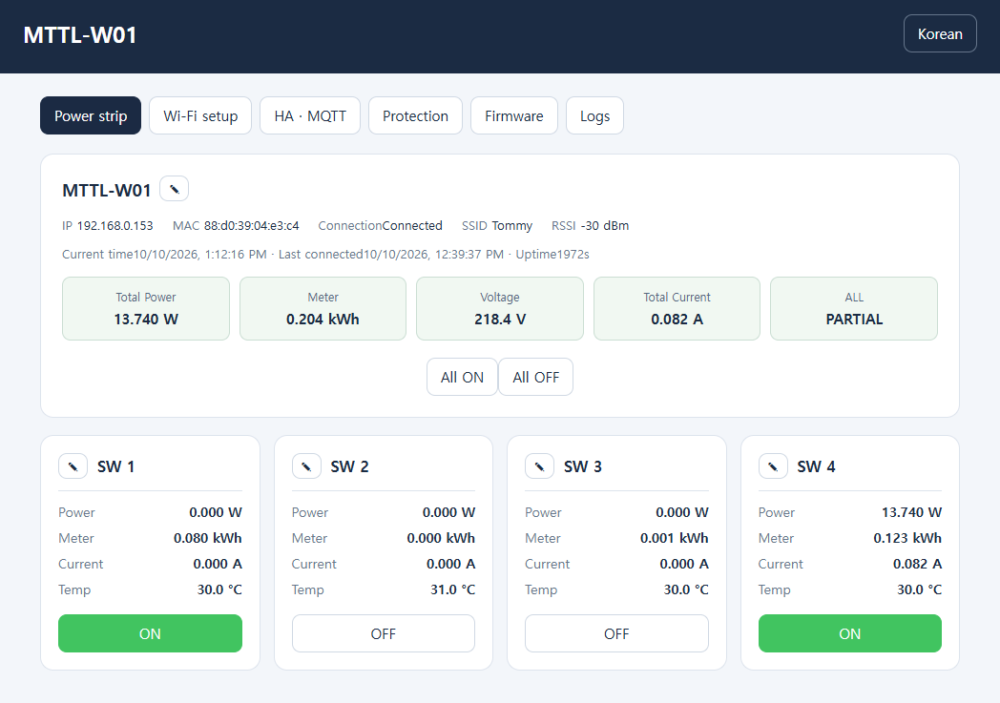

# MTTL-W01 Standalone Firmware

[한국어](README.md) | English

> **Users of 2.0.x are advised to upgrade to 2.1.x or later.** Version 2.0.x repeatedly saves settings and energy data to a small set of fixed flash sectors, which can accumulate wear during prolonged use. Version 2.1.x uses 128KiB circular storage and hourly energy saves to reduce erase frequency and distribute wear. This does not mean an existing device has already exhausted its flash endurance. **On the first upgrade from 2.0.x to 2.1.x, existing settings and energy data are not migrated; Wi-Fi and other settings must be configured again.**

Project-authored code is available under the [MIT License](LICENSE). Third-party components retain their existing terms. [License scope](LICENSING.md)

## Prebuilt firmware — ready to install

Download and install the FWR below without building it yourself.

Direct Wi-Fi web control and Home Assistant MQTT integration for the LG U+
MTTL-W01, without a separate backend or router DNAT.

### Firmware download

**2.1.1 / build `33231c0032fa013b` · October 22, 2026**

[Download comMTTL-W01_2.1.1.fwr](firmware/comMTTL-W01_2.1.1.fwr)

SHA-256: `362f92df30f16fadcfd012ba20557ce58466f08706e99bca6cf6e1f67ae1ce9f`

> **First installation of 2.1.x:** Settings and energy from 2.0.x are not migrated. After reboot, join `MTTL-W01-SETUP` and reconfigure Wi-Fi and other settings. The device may not return to its old IP. Web downgrade to 2.0.x is unsupported; Recovery 1.0.0 does not support the new storage format.

Existing standalone users can update through the device's **Firmware** tab.

Compatibility with every hardware variant is not guaranteed. Failed installation
may require debugger recovery. Software protection cannot replace hardware safety devices.
Power cutoff was verified on the test device using a 1000W threshold and a hair dryer load. Current/temperature cutoff and measurement accuracy still require separate hardware verification.

### Save cumulative energy before disconnecting power

Version 2.1.x saves cumulative energy at each hourly boundary. An unexpected power disconnection can therefore lose **up to approximately one hour of energy accumulated since the last save.**

Before a planned disconnection, choose a channel that can be operated without disrupting connected equipment, actually **switch it ON or OFF**, and **wait at least ten seconds after the last switch command has completed** before disconnecting power. Saving relay states also saves the current cumulative energy. Change the actual state rather than sending ON to a channel that is already ON. Any further switch operation restarts the waiting period from its completion. This preserves the readings available at save time; it does not guarantee against losses caused by an outage or a failed save.

## Features

- Per-channel physical-button locks: web/HA/schedules/protection remain active; blocked button actions flash the affected LEDs three times
- Configurable temperature, total-current and total-power protection with all-channel cutoff
- Up to eight schedules: daily, selected weekdays, monthly date or month-end, controlling one or all channels

- SoftAP Wi-Fi setup/scan, LAN Wi-Fi changes and automatic reconnection
- Individual/all channel control, physical buttons and LEDs
- Total power/energy/voltage/current and per-channel power/energy/current/temperature
- Editable device/channel names, Korean/English UI, NTP and browser-session logs
- HA MQTT Discovery: five switches and twenty sensors
- SSE updates, optimistic web controls and confirmed logical-state reporting to HA
- FWR web OTA, persistent settings/energy and enabled watchdog
- Restore to stock 1.0.66 or local-patched 1.0.68 FWR
- Reset total and per-channel energy when holding the physical main button for ten seconds to enter Wi-Fi setup

Sensors update approximately every ten seconds. Channel current subtracts 0.019 A
and clamps negative results to zero. Relay state is logical, not physical contact
feedback. It is saved ten seconds after the last completed control; earlier power
cuts may restore an older displayed state.

## Requirements

MTTL-W01, 2.4 GHz open/WPA2 Personal Wi-Fi, and a Wi-Fi-capable Windows x64 PC or
Apple silicon Mac for initial installation. HA requires an MQTT broker/integration.

## Initial installation: Windows / macOS OTA tool

Use [ttaengz's OTA tools](https://github.com/ttaengz/mttl-w01-matterbridge#펌웨어-업데이트).
Download the **OTA tool**, not the separate Wi-Fi configuration tool. Follow the
upstream instructions for supported operating systems and tool controls.

1. Download this repository's `comMTTL-W01_2.1.1.fwr` and the OTA tool for your operating system.
2. Hold the stock device's main button for at least ten seconds to enter setup.
3. Connect the PC to `TONLY_TAP_xxxxxxx`, using password `LGU_xxxxxxx` with the
   same suffix shown in the AP name.
4. Select **this repository's FWR** in the tool and transfer it following its prompts.
   You do not need the MatterBridge server or that project's firmware.
5. Keep power connected. After reboot, check for `MTTL-W01-SETUP`.

## Wi-Fi configuration

1. Join the open `MTTL-W01-SETUP` AP and visit `http://192.168.4.1`.
2. In Wi-Fi, scan/select an SSID, enter its password and connect.
3. Find the assigned IP in your router and open `http://DEVICE_IP`.

Hold the main button for ten seconds to reopen setup. LAN Wi-Fi changes are also
supported; find the new address after switching networks. Router outages trigger
saved-network retries, while manually entered setup mode stays available.

## Home Assistant

1. Configure HA's MQTT integration.
2. Enter broker address, port and credentials in the device MQTT tab.
3. Enable MQTT and save; Discovery registers the device and entities.

From 2.0.7, disabling MQTT and saving removes HA Discovery registrations.
Cleanup retries when broker connectivity returns; enabling MQTT again registers
the entities again. Keep the address and credentials of the broker holding the
existing registrations so cleanup can reach it.

Discovery uses `homeassistant`. IDs follow `switch.mttl_<last 7 MAC digits>_sw1`;
the aggregate switch ends in `_all`. Existing conflicts may cause HA to add a suffix.

## Local HTTP control API

Programs can request individual/all-channel ON/OFF through `POST /api/control` without MQTT. It uses a two-byte binary body and an `Origin` header, not address-bar GET control. See the [request format, responses and Python/JavaScript examples](docs/HTTP_API_EN.md).

## Subsequent updates: device web OTA

1. Download the latest standalone `.fwr`.
2. Open the device's Firmware tab, select the file and upload.
3. Keep power connected, reconnect after automatic reboot and verify the build.

Do not upload BIN files or full-flash dumps to the standalone updater.
No manual SHA-256 or token is required; internal image/slot checks remain enabled.
If transfer disconnects, close other device tabs, check the running build, then retry.

## Restore to stock / local firmware

Stock `1.0.66` FWR is available in the [original repository's stock firmware directory](https://github.com/af950833/mttl_w01/tree/main/work/firmware/1.0.66).

On **2.0.5 or later**, select a stock `1.0.66` or backend-oriented local-patched
`1.0.68` FWR in the Firmware tab and upload it. Keep power connected throughout
transfer and reboot. Other versions and arbitrary formats are unsupported.

- Restoration ends the standalone web dashboard and direct HA MQTT integration.
- Stock firmware may require its original provisioning/service setup again.
- Local 1.0.68 requires a file generated for the correct backend IP and that backend server.
- Remove remaining standalone HA entities manually if needed.
- To return to standalone, use the **initial-installation OTA tool** described above.

There is no fixed file-digest allowlist. Image format, size, checksum, SHA-256
receive/readback consistency and slot compatibility are still checked. These
checks are not signature authentication; use FWR files from trusted sources only.
The OTA/restore path passed 142 ARM-execution tests with mocked flash;
restoration to local-patched `1.0.68` and successful boot have been verified on a physical device. Stock `1.0.66` restoration from standalone `2.0.9`, boot into the original setup AP, and normal operation after reprovisioning have also been confirmed on a user's device ([user verification report #2](https://github.com/af950833/mttl_w01_standalone/issues/2)).

## Verification and safety

Repeated web OTA, settings/state persistence, Wi-Fi changes, MQTT broker restart
and router-reboot recovery were verified on the development device. With 2.0.10, automatic reconnection was also verified when the strip starts before the router after a power outage. Actual watchdog
stall recovery, all variants, measurement accuracy and long-term stability remain unverified.

Trusted LANs only: HTTP/MQTT are unencrypted; there is no web login, OTA token or
firmware signature authentication. Never expose ports to the Internet. Origin checks
are not user authentication.

Firmware and builder sources and build instructions are available. The builder downloads the SDK and compiler separately from upstream distribution sites.

## Scheduler

1. Open the **Scheduler** tab and select a time zone. The default is UTC+09:00; offsets from UTC−12:00 to UTC+14:00 are available in 15-minute steps. DST is not applied automatically.
2. Use **Add rule** to create up to eight rules. Choose the recurrence, time, target channel and ON/OFF action. Each rule can be enabled, disabled or deleted.
3. **Save to device** persists the rules in flash across reboot.

Recurrence options are daily, selected weekdays, monthly date (1–31), and the last day of each month. Missing dates are skipped; month-end and leap years are calculated automatically. Targets are channels 1–4 or all channels. Later rows win conflicting actions for the same channel at the same time.

Execution requires NTP synchronization. Initial synchronization, reboot and schedule edits anchor the current minute; execution starts with subsequent minutes. Missed events are not replayed. A busy relay queue is retried only within the scheduled minute. Batches require room for all scheduled channel commands; they are not partially admitted.

Existing settings migrate with empty schedules. Saving settings after downgrading to older firmware may clear schedules. Existing protection and manual controls remain in use.

## Protection settings

| Item | Range | Initial default | Trip condition |
| --- | --- | --- | --- |
| Temperature | 50–90 °C | Enabled, 90 °C | First excess on any channel |
| Total current | 1–16 A | Enabled, 16 A | Corrected sum exceeds threshold in two consecutive rounds |
| Total power | 100–3000 W | Enabled, 3000 W | Total power exceeds threshold in two consecutive rounds |

Press **Apply** to persist settings across reboot and OTA. First upgrade from an older release enables the defaults above.
A complete sequential measurement round takes approximately 10 seconds; this is not continuous monitoring. Equality does not trip.
Read failures report an error and reset the affected consecutive counter. Existing power conversion is unchanged.
There is no protection lock or automatic ON. Users may turn channels on again; continued excess trips again.
The new 2.0.8 settings codec cannot be read by 2.0.7 or earlier, so settings may not survive a downgrade to older standalone firmware.

## Home Assistant Lovelace card

See the [MTTL-W01 2.0 card installation guide](ha-card/README_EN.md) for standalone firmware 2.0.x. It displays total/per-channel sensors and timers.

## Reset cumulative energy

**On 2.0.9 and later, holding the physical main button for at least ten seconds to enter setup SoftAP resets total and all four channel energy readings to zero. This also resets energy when entering setup solely to change Wi-Fi.**

Current metering counters become the new baseline, so only subsequent increments are accumulated. The reset is immediately saved to flash and survives reboot. Relay states, Wi-Fi/MQTT/protection settings and device/channel names are preserved. Ordinary reboot and automatic SoftAP entry do not reset energy.

A held button triggers only once. Setup entry waits for valid channel counters and successful persistence, so sensor/storage errors may delay entry. A failed save preserves previous totals.

## Physical-button locks

Use 🔓/🔒 at the top right of each channel card. Locks apply only to physical buttons and do not change the current relay state. Pressing a locked channel button flashes that channel LED three times without switching its relay. The main button controls only unlocked channels and flashes all locked channel LEDs. If all channels are locked, the main button does not switch any relay.

Web/HA individual and all-channel ON/OFF, schedules and protection remain functional while locked. Locks persist across reboot and OTA. The existing ten-second main-button Wi-Fi setup action and associated energy reset remain unchanged.

## Timers

Set each channel to 1 minute–24 hours in the Timer tab and select **Save to device**. Save zero hours and minutes to remove a timer. A channel may belong to either timers or schedules, not both.

OFF→ON starts the timer; OFF cancels it. Repeated ON commands do not restart it. Changing a running timer's duration starts the new full duration. Channels restored ON after reboot also restart the full duration; remaining time is not persisted. Expiry turns the channel OFF regardless of its physical-button lock.

## Firmware Builder 1.0.0 and source

[Download Builder 1.0.0](https://github.com/af950833/mttl_w01_standalone/releases/tag/builder-v1.0.0) · [Firmware 2.1.1 and Source ZIP](https://github.com/af950833/mttl_w01_standalone/releases/tag/v2.1.1)

[Builder usage guide](builder/README_EN.md) · [Firmware source guide](source/README_EN.md)

The developer accepts no responsibility for problems or consequences arising from user modifications or self-built firmware. Questions and troubleshooting requests related to user modifications or builds are not supported. Please do not open issues for these topics.

## Wired recovery — ST Link V2

> **Recovery 1.1 supports restoring 2.1.x and earlier standalone firmware to stock 1.0.66. Settings/energy are erased; physical recovery testing of the integrated tool is still pending.**

If a problem during a firmware update makes web OTA unavailable, see the [ST Link V2 recovery tool and wiring/usage guide](recovery/README_EN.md) for wired recovery. Full AC-board disconnection is mandatory; read the tool's validation limits and safety instructions first.

## Version History

### 2.1.1 — October 22, 2026

- Display the last flash-write time, latest save-attempt status and save-failure count since boot on the power-strip dashboard.
- Track physical saves for settings, relay states, energy and OTA checkpoints. Unchanged payloads do not update the last-write time.
- Keep diagnostics in RAM only, with no extra flash writes or polling requests. After reboot, show no writes since boot / waiting / zero failures. Stored settings and energy remain intact.
- Show time not synchronized for writes before clock synchronization. The existing status poll may take about 20 seconds to reflect a write.
- Retain the 2.1.0 128KiB journal format, hourly energy saves and ten-second relay-save debounce. Settings and energy are preserved when upgrading from 2.1.0.
- Storage telemetry, persistence/OTA and web regression checks passed. The user confirmed normal operation after installing on a physical device.

### 2.1.0 — October 20, 2026

- Append full settings, energy checkpoints and logical relay states as 1KiB records across two 64KiB banks (128KiB total), with four records per 4KiB sector before moving on.
- Use sequence numbers, CRCs, a final completion marker and readback validation to recover the newest valid record. Skip unchanged payloads.
- Save cumulative energy at each local hourly boundary using the configured timezone. Before NTP synchronization, use a one-hour interval; suppress repeated hours after backward clock corrections.
- Retain saves on configuration apply, ten seconds after the last completed relay command, energy reset and OTA checkpoint.
- **No migration from 2.0.x. On first installation, reconfigure Wi-Fi, MQTT, names, locks, protection, schedules and timers. Energy starts at zero from the first valid metering observation.**
- Enforce separate OTA end boundaries to protect both storage banks, preserving boot, OEM parameters, factory and calibration areas.
- Initial boot, web/sensor responses and persistent configuration status after Wi-Fi setup were confirmed on the test device. Hourly persistence, reboot restoration and long-term stability still require separate physical verification.
- **Web downgrades to 2.0.x are unsupported. Recovery tool 1.0.0 is not compatible with the new storage format.**

### 2.0.18 — October 20, 2026

- Center the Channel 1–4 headings in the Timer tab cards.
- Double the log window height from 300px to 600px.
- Correct operation confirmed by the user on their device.

### 2.0.17 — October 18, 2026

- Bundle Firmware-tab initialization with the common controller to prevent a separate script download failure from leaving labels and buttons blank.
- Load common scripts sequentially on all tabs and retry failed downloads after three seconds with a loading notice.
- Add an eight-second firmware-status request timeout, three-second retry on failure, and refresh on Firmware-tab selection or browser visibility restoration.
- After a successful standalone update, wait five seconds, then check reconnection every three seconds for up to two minutes. Reload the Firmware tab only after a new Build ID is observed.
- Show manual reconnect instructions on timeout, without automatically resending firmware. Preserve same-image and stock-restore behavior.
- Installing this version from an older page requires one manual refresh. Automatic reload applies to subsequent updates initiated from the refreshed UI.
- Align web UI, MQTT Discovery and web API version labels to 2.0.17.

### 2.0.16 — October 18, 2026

- HA timer sensors now show the configured duration while OFF: a five-minute setting publishes 300 seconds retained.
- While ON, remaining time continues to update every five seconds.
- Publish the new value once on transition to OFF or an idle setting change, without periodic idle traffic.
- Resynchronize current values on MQTT reconnection or HA restart. Existing HA cards and entities remain compatible.
- Correct operation confirmed by the user on their device.

### 2.0.15 — October 17, 2026

- Identical image uploads now show “This firmware is already installed” instead of a general OTA error, without reboot or activation (updated build `6c20881eb798b297`).
- Added four per-channel HA timer number settings and four remaining-time sensors (#12).
- Active countdowns publish retained every five seconds; expiry/cancellation sends zero once, without periodic idle traffic.
- Twenty measurement sensors check one slot every 500ms and publish changes. Fresh unchanged readings heartbeat about every 300 seconds; HA expiry is 600 seconds.
- HA card Timer rows show HH:MM:SS remaining time and open the matching timer number settings on tap.
- Schedule-owned channels reject nonzero timer settings and republish the actual setting of zero.

### 2.0.14 — October 17, 2026

- Per-channel automatic OFF timers: 1 minute–24 hours, starting on OFF→ON; OFF cancels and the next ON starts a full duration
- Timers and schedules cannot share a channel. ALL schedules occupy every channel; disabled schedules still reserve their targets until deleted
- Settings persist in flash. Channels restored ON after reboot restart the full configured duration
- Dedicated Timer tab and fixed HH:MM:SS timer rows on every channel: configured duration while idle, remaining time while running
- Improved lock-save confirmation under intermittent communication failures; removed unrelated post-save device queries
- Avoid unnecessary MQTT reconnects when changing locks, timers, schedules or protection settings
- Wi-Fi setup initially displays the actual connection state instead of Not connected (#10)
- Timer behavior and fixes confirmed by the user on hardware

### 2.0.13 — October 16, 2026

- Channel-card padlocks configure physical-button locks, saved in flash across reboots; older settings migrate to unlocked
- Locked channel buttons do not switch relays; the main button controls only unlocked channels and does nothing to relays if all channels are locked
- Web/HA individual/all controls, schedules and protection bypass physical locks; the ten-second main-button Wi-Fi setup action is unchanged
- A blocked channel press flashes only that LED three times; a main-button press flashes every locked channel LED, then restores the current indicators
- Only the selected web padlock is disabled during saving; changes to multiple channels are saved sequentially
- Refreshed dashboard with system fonts, revised cards/buttons/inputs and a two-by-two mobile channel layout
- Shorter Korean channel energy label; consistent metadata colons/spacing and uptime in days, hours, minutes and seconds
- Removed device-side draft/simulation HTML, translations and display code; FWR filenames omit the build ID while retaining it internally
- Moved the status cache to TCM while preserving the RTOS heap and 4KiB MSP reservation; user verified locks and the updated UI on hardware

### 2.0.12 — 2026-10-14

- Fixed unresponsive Wi-Fi scan requests and device restarts occurring in 2.0.11
- Allocate the scan response buffer on the heap only for the request, reducing the handler's local stack frame from 3,168 to 864 bytes
- Return an HTTP error on allocation failure and free the buffer after both successful responses and transmission failures
- Passed tests for sixteen maximum-length SSIDs, allocation/write failures and existing scheduler, settings, relay, SSE and protection paths
- Preserve existing heap/stack reservations and the scan cache; normal Wi-Fi scanning confirmed in user device testing

### 2.0.11 — 2026-10-14

- Added a dedicated Scheduler tab and up to eight flash-persisted rules
- Daily, selected weekdays, monthly date and month-end; individual/all-channel ON/OFF, enable controls and deletion
- Automatic month-end/leap-year calculation, missing-date skipping and later-row precedence for conflicts
- Fixed UTC offset selection, NTP gating and no replay of events missed during reboot or clock correction
- Atomic batch admission through the existing relay queue, with retries only within the scheduled minute
- Single-bordered time editor with Korean 오전/오후 and English AM/PM
- Compressed web assets and on-demand settings JSON preserve existing heap/stack reservations
- Passed 470 scheduler ARM checks plus UI, settings, relay, SSE and memory checks; successful operation confirmed in user device testing

### 2.0.10 — 2026-10-11

- Fixed failure to reconnect to saved Wi-Fi when the router starts later than the strip after a full power outage ([#1](https://github.com/af950833/mttl_w01_standalone/issues/1))
- Removed setup SoftAP/HTTP startup success as a prerequisite for saved-network retry
- Retry safe network cleanup/recovery after 15 seconds in the fault state, with no fixed limit on saved-network connection attempts
- Preserve manual setup, relay states, settings and energy totals; automatic recovery does not reset energy
- Physically verified automatic reconnection without another strip power cycle when the router is switched on after the strip boots
- Passed 142 mocked OTA tests and existing-function regression checks

### 2.0.9 — 2026-10-10

- Reset total and per-channel cumulative energy on a ten-second physical main-button hold that enters setup SoftAP
- Rebase on current metering counters and immediately persist the reset; accumulate only subsequent increments
- Preserve relay states and other settings; ordinary reboot and automatic SoftAP entry do not reset energy
- Preserve previous totals on save failure and prevent repeated resets during a single hold
- Improve web-asset gzip compression without reducing existing heap/stack reservations
- Passed offline reset/persistence/reboot checks and 142 mocked OTA tests; energy reset verified on the test device

### 2.0.8 — 2026-10-10

- Added a Protection tab with slider-adjustable temperature, total-current and total-power thresholds and independent enable controls
- Persist applied settings across reboot/OTA; migrate existing configuration, energy checkpoints and logical relay state
- All OFF on the first excessive channel temperature or two consecutive fresh rounds of excessive total current/power
- Current protection sums channel readings after subtracting 0.019 A per channel and clamping to zero; existing power conversion is unchanged
- Read failures report errors and reset affected consecutive counters; no protection lock or automatic ON after cutoff
- Display live slider values/units in a dedicated column that stays visible while adjusting
- Verified 1000W power cutoff on the test device; temperature/current cutoff not yet physically verified

### 2.0.7 — 2026-10-09

- Remove Discovery registrations for five switches and twenty sensors, plus retained availability, when MQTT is disabled
- Fence deletion delivery with a broker response, retry after connection failures, and rediscover when enabled again
- Green backgrounds and white text for web ON buttons; unchanged OFF styling

### 2.0.6 — 2026-10-08

- Publish confirmed aggregate and channel switch states with `retain=true` so HA receives the last reported state after a late subscription
- Republish unchanged channel states when HA reconnects
- Keep sensor publications at `retain=false` with existing real-time updates and expiry behavior
- Verified 2.0.6 OTA, reboot, MQTT reconnection and preserved channel states on the development device

### 2.0.5 — 2026-10-08

- Optimized relay drive/release for faster successive channel and all-channel control
- Web restore support for stock 1.0.66 and local-patched 1.0.68 FWR
- Retained image-format, checksum and flash-readback validation without a fixed restore-file digest allowlist

### 2.0.0 — 2026-10-07

- Initial public standalone firmware release
- SoftAP/LAN Wi-Fi setup and automatic reconnection
- Individual/all relay control, physical buttons/LEDs and persistent channel state
- Total/per-channel sensors and Home Assistant MQTT Discovery integration
- Korean/English web dashboard, SSE updates and FWR web OTA
- Persistent settings/energy and enabled watchdog
